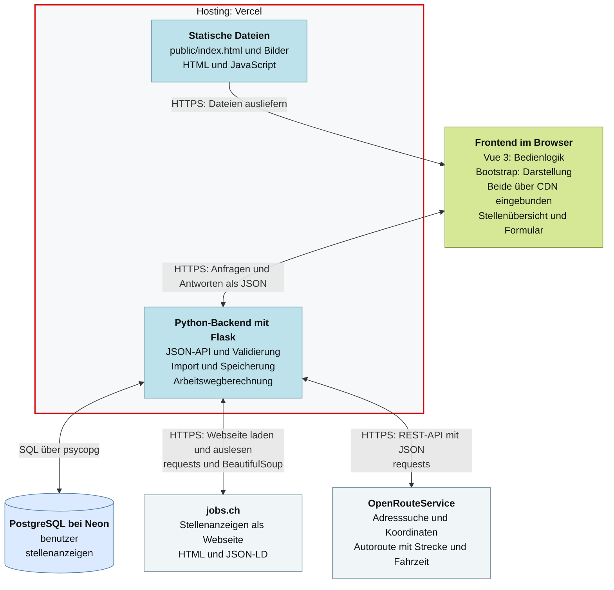

!! Change this document for your own project by removing the placeholder text, adding your own text, adding helpful sections etc. etc. !!

# <Project Title>

In a few sentences describe what your project is trying to solve.

You can use [GitHub markdown
notation](https://docs.github.com/en/github/writing-on-github/getting-started-with-writing-and-formatting-on-github/basic-writing-and-formatting-syntax)
or [GitLab markdown notation](https://docs.gitlab.com/ee/user/markdown.html) in
case you are using one of these platforms. This will give a nicely formatted
documentation when looking at your project online.

## Get started

Die folgenden Befehle laufen im Projektordner `JobTracker`, auf macOS im
Terminal und auf Windows in der PowerShell gleich.

1. Abhängigkeiten installieren bzw. aktualisieren:

   ```bash
   uv sync --all-groups
   ```

2. Die Datei `.env` im Projektordner braucht die Einträge `DATABASE_URL`
   (Neon) und `OPENROUTESERVICE_API_KEY`. Sie ist nicht in Git.

3. Server starten:

   ```bash
   uv run flask --app src/app run --debug --port 5001
   ```

   In VS Code geht das auch über *Terminal → Run Task… → JobTracker starten*.

4. Im Browser http://localhost:5001 öffnen. Nach einer Codeänderung lädt der
   Server von selbst neu. Mit `Ctrl+C` wird er beendet.

Lokal verwenden wir den Entwicklungsserver von Flask statt gunicorn: gunicorn
läuft auf Windows nicht und stürzte auf macOS nach dem Neuladen ab
([ADR 0012](docs/decisions/0012-lokaler-server-mit-flask-run.md)).

**Wichtig:** `--debug` nie zusammen mit `--host 0.0.0.0` verwenden. Die
Fehlerseite im Debug-Modus erlaubt es, Python-Code auszuführen. Ohne
`--host` ist der Server nur auf dem eigenen Rechner erreichbar.

**«Failed to fetch» im Browser?** Dann hat der Server gar nicht geantwortet.
Zuerst ins Terminal schauen, in dem der Server läuft: Dort steht die Ursache.

Tests laufen mit:

```bash
uv run pytest
```

## Local deployment

If you have installed Docker locally, you can test your application in a local
deployment using the `Dockerfile`. For this you first have to build the entire
application into a Docker image:

```bash
    docker build . -t webapp
```

Now you can run this Docker image and check if your server is really starting
correctly. Use the following command. Notice that the part `webapp` needs to
match with whatever you chose when creating the image in the previous step:

```bash
    docker run -p 8000:8000 webapp
```

You should now be able to open your web browser under the URL 
http://localhost:8000 and you should be greeted with a very simple page.

## Understanding the sources

Explain any high level concepts that you are using in your software. What were
your ideas for creating the whole software? What might not be apparent from the
sources alone? You can also add diagrams, photos of whiteboards or flipcharts
or even crudly drawing napkin sketches of the core concepts of your software
when they are readable and helpful for understanding.


## Systemarchitektur

