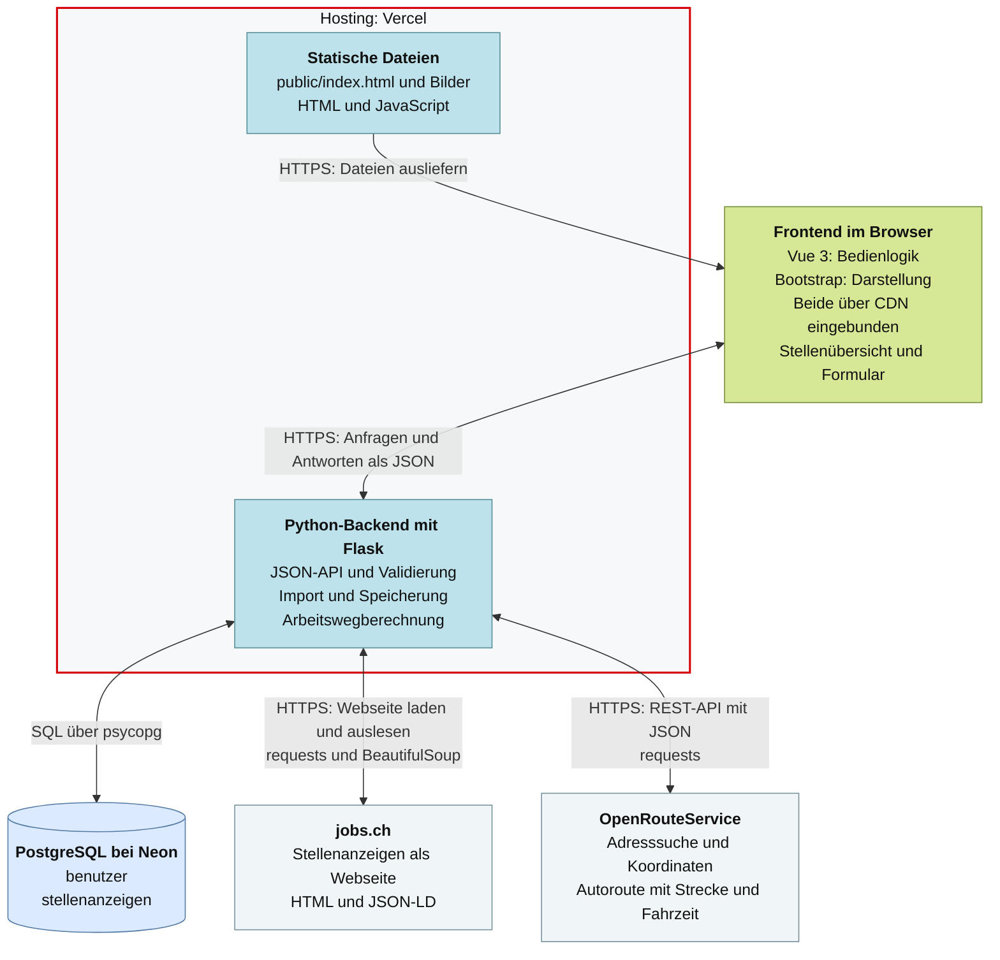

# JobTracker

JobTracker hilft bei der Stellensuche, den Überblick über die eigenen
Bewerbungen zu behalten. Wer sich auf mehrere Stellen bewirbt, verliert schnell
den Überblick: Welche Stellen habe ich mir gemerkt, wo habe ich mich schon
beworben, wie weit wäre der Arbeitsweg? JobTracker sammelt diese Angaben an
einem Ort.

Die Webapplikation ist das Gruppenprojekt im Modul SWEN (HSLU, HS2026).

**Live:** <https://jobtracker-swen.vercel.app>
<!-- TODO: Adresse in Vercel bestätigen, siehe ADR 0014 -->

## Was die Applikation kann

Die Funktionen sind in drei Use Cases aufgeteilt. Jeder Use Case besteht aus
kleinen User Stories, die einzeln umgesetzt wurden.

| Use Case | Was der Nutzer tun kann | Beschreibung |
|---|---|---|
| **1 – Stelle erfassen** | Einen Link von jobs.ch einfügen. JobTracker liest Titel, Firma, Arbeitsort, Adresse, Pensum und Beschreibung aus der Anzeige und zeigt sie als Vorschau. Fehlende Angaben ergänzt der Nutzer und speichert die Stelle. | [Use_Case_1](docs/Use_cases/Use_Case_1/) |
| **2 – Stellen verwalten** | Alle Stellen in einer Übersicht sehen, eine Stelle öffnen, den Bewerbungsstatus und weitere Angaben ändern und Stellen löschen. | [Use_Case_2](docs/Use_cases/Use_Case_2/README.md) |
| **3 – Arbeitsweg berechnen** | Beim Speichern berechnet JobTracker Strecke und Fahrzeit mit dem Auto von der Wohnadresse zum Arbeitsort und zeigt sie bei der Stelle an. | [Use_Case_3](docs/Use_cases/Use_Case_3/README.md) |

Bewusst weggelassen haben wir Login, mehrere Benutzer, Suche und Filter
([ADR 0003](docs/decisions/0003-benutzer-ohne-login.md),
[ADR 0010](docs/decisions/0010-minimale-oberflaeche.md)). Alle Stellen gehören
einem fest hinterlegten Demo-Benutzer.

## Systemarchitektur



Das Frontend schickt alle Anfragen an das Flask-Backend. Nur das Backend
spricht mit der Datenbank und mit den externen Diensten. So bleiben der
API-Schlüssel und die Zugangsdaten zur Datenbank auf dem Server.

Das Datenmodell mit beiden Tabellen und allen Regeln steht in
[docs/datenmodell.md](docs/datenmodell.md).

## Technologie-Entscheide

Jeder wichtige Entscheid ist als Architecture Decision Record (ADR) in
[docs/decisions/](docs/decisions/) festgehalten, mit den betrachteten
Alternativen und der Begründung.

| Bereich | Entscheid | ADR |
|---|---|---|
| Backend | Python mit Flask | [0001](docs/decisions/0001-System_architektur.md) |
| Frontend | Vue 3 und Bootstrap über CDN, ohne Build-Schritt | [0001](docs/decisions/0001-System_architektur.md), [0013](docs/decisions/0013-bootstrap-fuer-die-darstellung.md) |
| Datenbank | PostgreSQL bei Neon statt SQLite | [0007](docs/decisions/0007-postgresql-bei-neon.md) |
| Hosting | Vercel | [0001](docs/decisions/0001-System_architektur.md), [0014](docs/decisions/0014-domain-und-jobtracker-logo.md) |
| Externer Dienst | OpenRouteService für den Arbeitsweg (ersetzt den Plan mit Google Maps aus [0002](docs/decisions/0002-externe-web-api.md)) | [0008](docs/decisions/0008-arbeitsweg-mit-openrouteservice.md), [0011](docs/decisions/0011-strukturierte-adresssuche.md) |
| Import | Stellenanzeigen nur von jobs.ch, aus der Anzeigenseite gelesen | [0006](docs/decisions/0006-import-nur-von-jobs-ch.md) |
| Benutzer | Ein Demo-Benutzer ohne Login, vorbereitet für mehrere Benutzer | [0003](docs/decisions/0003-benutzer-ohne-login.md) |
| Oberfläche | Zwei Screens: Übersicht und ein Formular für Erfassen und Bearbeiten | [0005](docs/decisions/0005-ein-formular-fuer-erfassen-und-bearbeiten.md), [0010](docs/decisions/0010-minimale-oberflaeche.md) |
| Adressen | Drei Felder ohne Prüfung, getrennt vom angezeigten Arbeitsort | [0004](docs/decisions/0004-adresse-getrennt-vom-arbeitsort.md), [0009](docs/decisions/0009-adresse-in-drei-feldern.md) |
| CI | Tests und Stilprüfung bei jedem Push mit GitHub Actions | [0016](docs/decisions/0016-ci-mit-github-actions.md) |
| Lokale Entwicklung | `flask run` statt gunicorn | [0012](docs/decisions/0012-lokaler-server-mit-flask-run.md) |
| Dokumentation | Systemarchitektur als Mermaid-Diagramm | [0015](docs/decisions/0015-systemarchitektur-mit-mermaid.md) |
## Wo finde ich was im Code?

| Frage | Ort |
|---|---|
| Einstiegspunkt: Was passiert beim Start? | [`src/app/__init__.py`](src/app/__init__.py): lädt die `.env`, erstellt die Flask-App, liest die Konfiguration und registriert die Routen |
| Endpunkte des Backends | [`src/app/stellenanzeigen_routes.py`](src/app/stellenanzeigen_routes.py) |
| Datenbank: Tabellen anlegen, lesen, schreiben | [`src/app/datenbank.py`](src/app/datenbank.py), Funktion `tabellen_erstellen()` |
| Import von jobs.ch (externe Webseite) | [`src/app/stellenanzeige_erfassen.py`](src/app/stellenanzeige_erfassen.py) |
| Arbeitsweg mit OpenRouteService (externe API) | [`src/app/arbeitsweg.py`](src/app/arbeitsweg.py) |
| Frontend | [`public/index.html`](public/index.html): HTML, Vue 3 und Bootstrap in einer Datei |
| Tests | [`tests/`](tests/) |
| CI-Pipeline | [`.github/workflows/ci.yml`](.github/workflows/ci.yml) |
| Abhängigkeiten | [`pyproject.toml`](pyproject.toml) und [`uv.lock`](uv.lock) |
| Use Cases und User Stories | [`docs/Use_cases/`](docs/Use_cases/) |

### Endpunkte des Backends (eigene API)

Diese Endpunkte bietet unser Flask-Backend an, und das Frontend ruft sie auf.
Die Endpunkte unter `/api/stellenanzeigen` lesen und schreiben dabei die
Tabelle `stellenanzeigen` in der Datenbank. Einzige Ausnahme ist die
Vorschau: Sie liest nur die Anzeige auf jobs.ch und speichert nichts. Das
Frontend greift nie direkt auf die Datenbank zu, sondern immer über diese
Endpunkte.

| Methode | Pfad | Zweck |
|---|---|---|
| `GET` | `/api/status` | Prüft, ob das Backend läuft |
| `GET` | `/api/datenbank/status` | Prüft, ob die Datenbank erreichbar ist |
| `POST` | `/api/stellenanzeigen/vorschau` | Liest eine jobs.ch-Anzeige und gibt die Felder als Vorschau zurück |
| `POST` | `/api/stellenanzeigen` | Speichert eine neue Stelle und berechnet den Arbeitsweg |
| `GET` | `/api/stellenanzeigen` | Liefert alle Stellen für die Übersicht |
| `GET` | `/api/stellenanzeigen/<id>` | Liefert eine einzelne Stelle |
| `PUT` | `/api/stellenanzeigen/<id>` | Ändert eine Stelle und berechnet den Arbeitsweg neu |
| `DELETE` | `/api/stellenanzeigen/<id>` | Löscht eine Stelle |

Für den Arbeitsweg gibt es keinen eigenen Endpunkt. Er wird bei `POST` und
`PUT` mitberechnet: Beide Routen rufen `arbeitsweg_eintragen()` aus
[`src/app/arbeitsweg.py`](src/app/arbeitsweg.py) auf.

### Externe Dienste

Diese Adressen ruft das Backend selbst über die Bibliothek `requests` auf.
Das Frontend spricht nie direkt mit ihnen.

| Dienst | Methode | Adresse | Zweck | Im Code |
|---|---|---|---|---|
| OpenRouteService | `GET` | `https://api.openrouteservice.org/geocode/search/structured` | Wandelt eine Adresse in Koordinaten um | `koordinaten_suchen()` in [`arbeitsweg.py`](src/app/arbeitsweg.py) |
| OpenRouteService | `POST` | `https://api.openrouteservice.org/v2/directions/driving-car` | Berechnet Strecke und Fahrzeit mit dem Auto | `arbeitsweg_berechnen()` in [`arbeitsweg.py`](src/app/arbeitsweg.py) |
| jobs.ch | `GET` | `https://www.jobs.ch/de/stellenangebote/detail/<jobid>/` | Lädt die Anzeigenseite und liest die Felder aus dem HTML | `stellenanzeige_auslesen()` in [`stellenanzeige_erfassen.py`](src/app/stellenanzeige_erfassen.py) |

OpenRouteService braucht einen API-Schlüssel (`OPENROUTESERVICE_API_KEY`).
jobs.ch ist keine API, sondern eine normale Webseite
([ADR 0006](docs/decisions/0006-import-nur-von-jobs-ch.md)).

### Was passiert bei Fehlern?

- **Datenbank nicht erreichbar:** Die Routen fangen `psycopg.Error` ab und
  antworten mit Status `503` («Dienst gerade nicht verfügbar») und einer
  kurzen Meldung statt mit einem Absturz.
- **OpenRouteService nicht erreichbar oder Adresse unbrauchbar:** Die Stelle
  wird trotzdem gespeichert. Strecke und Fahrzeit bleiben leer, und die
  Oberfläche zeigt «Arbeitsweg konnte nicht berechnet werden.»
- **jobs.ch nicht erreichbar:** Die Vorschau meldet den Fehler. Der Nutzer
  kann die Angaben auch von Hand erfassen.

## Lokal starten

Voraussetzung ist [uv](https://docs.astral.sh/uv/). Die folgenden Befehle
laufen im Projektordner `JobTracker`, auf macOS im Terminal und auf Windows in
der PowerShell gleich.

1. Abhängigkeiten installieren bzw. aktualisieren:

   ```bash
   uv sync --all-groups
   ```

2. Im Projektordner eine Datei `.env` mit zwei Einträgen anlegen. Sie ist in
   `.gitignore` eingetragen und kommt nie ins Repository.

   ```
   DATABASE_URL=...              # Verbindung zur PostgreSQL-Datenbank bei Neon
   OPENROUTESERVICE_API_KEY=...  # Schlüssel für OpenRouteService
   ```

3. Server starten:

   ```bash
   uv run flask --app src/app run --debug --port 5001
   ```

   In VS Code geht das auch über *Terminal → Run Task… → JobTracker starten*.

4. Im Browser http://localhost:5001 öffnen. Nach einer Codeänderung lädt der
   Server von selbst neu. Mit `Ctrl+C` wird er beendet.

## Tests

```bash
uv run pytest
```

Es gibt 74 Unit-Tests mit pytest. Sie zeigen am Ende auch die
Testabdeckung an (aktuell 85 %).

- **Ohne echte Datenbank und ohne Internet:** Die Tests ersetzen die
  Datenbank und die externen Dienste mit `monkeypatch` durch Attrappen. Sie
  brauchen deshalb weder eine Datenbankverbindung noch Internet und laufen in
  unter einer Sekunde. Ein Beispiel ist
  [`tests/test_arbeitsweg.py`](tests/test_arbeitsweg.py): Er prüft die
  Berechnung des Arbeitswegs, ohne OpenRouteService aufzurufen.
- **Routen mit dem Flask-Test-Client:** Tests wie
  [`tests/test_app.py`](tests/test_app.py) schicken Anfragen an die App, ohne
  dass ein Server laufen muss.
- Die Testdateien folgen den User Stories, z.B.
  [`tests/test_status_aendern.py`](tests/test_status_aendern.py) für US 20003
  oder [`tests/test_stelle_loeschen.py`](tests/test_stelle_loeschen.py) für
  US 20005.

## CI/CD

Die automatische Prüfung (CI) und das Ausliefern (CD) sind getrennt: GitHub
Actions prüft den Code, Vercel liefert ihn aus.

### CI mit GitHub Actions

Die Pipeline ist in [`.github/workflows/ci.yml`](.github/workflows/ci.yml)
definiert ([ADR 0016](docs/decisions/0016-ci-mit-github-actions.md)). Sie
läuft bei jedem Push und bei jedem Pull Request und führt dieselben Befehle
aus, die wir vor einem Commit auch von Hand ausführen:

1. `uv sync --locked --all-groups`: Abhängigkeiten installieren. `--locked`
   bricht ab, wenn `uv.lock` nicht zu `pyproject.toml` passt.
2. `uv run pytest`: Unit-Tests ausführen
3. `uv run ruff check .`: Code auf Fehler und Stilregeln prüfen
4. `uv run black --check .`: Formatierung prüfen

Im Pull Request erscheint danach ein grünes Häkchen oder ein rotes Kreuz.
Gemergt wird nur, wenn es grün ist. Die Pipeline braucht keine Secrets, weil
die Tests ohne Datenbank und ohne externe Dienste laufen.

### Deployment mit Vercel

Die Applikation läuft auf [Vercel](https://vercel.com). Vercel erkennt die
Flask-App über den Eintrag `[tool.vercel]` in
[`pyproject.toml`](pyproject.toml) (`entrypoint = "src.app:app"`) und liefert
die Dateien aus `public/` direkt aus.

<!-- TODO: prüfen und bestätigen, dass Vercel mit dem GitHub-Repo verbunden ist
     und jeden Merge auf master automatisch deployt -->
Vercel ist mit diesem GitHub-Repository verbunden. Jeder Merge auf `master`
löst automatisch ein neues Deployment aus.

`DATABASE_URL` und `OPENROUTESERVICE_API_KEY` sind auf Vercel als
Umgebungsvariablen hinterlegt, nicht im Code.

## Team

| Person | Schwerpunkt |
|---|---|
| Lina Schwonnek | Use Case 1: Stelle von jobs.ch importieren und erfassen |
| Mirko Gasser | Use Case 2: Übersicht, Stelle öffnen, ändern und löschen |
| Fabio <!-- TODO: Nachname --> | Use Case 3: Arbeitsweg mit OpenRouteService berechnen |

<!-- TODO: Schwerpunkte im Team bestätigen und ergänzen (z.B. Deployment, Datenbank, Frontend) -->

Datenbank und Frontend haben alle gemeinsam weiterentwickelt. Wer welche
Änderung gemacht hat, zeigen die Commits und Pull Requests auf GitHub. Unsere
Zusammenarbeit mit KI-Agenten beschreiben [AGENTS.md](AGENTS.md) und
[docs/agent-collaboration.md](docs/agent-collaboration.md).
