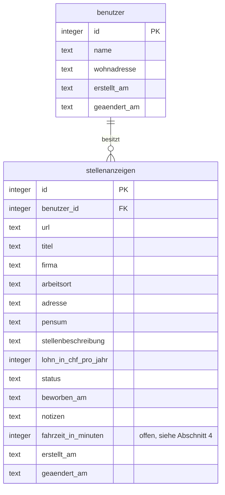

# Datenmodell JobTracker

Stand: 2026-10-19

> **Wichtig für alle Agenten:** Dieses Dokument ist die Grundlage für das
> Programmieren. Weicht etwas, das programmiert wird, von diesem Datenmodell
> ab, muss der Nutzer das wissen. Der Agent informiert ihn, welche
> Auswirkungen die Abweichung hat und warum sie nötig ist.

## 1 Grundsätze

- Zwei Tabellen: `benutzer` und `stellenanzeigen`.
- Namen nach den Team-Konventionen in
  [`code-stil.md`](../.agents/skills/learn-coding/references/code-stil.md):
  Deutsch, `snake_case`, ohne Umlaute, Einheit im Namen. Spaltennamen und
  JSON-Felder sind identisch.
- Die Typen sind logisch angegeben, weil die Datenbank für den Onlinebetrieb
  noch offen ist ([ADR 0001](decisions/0001-System_architektur.md)).
  Abschnitt 7 zeigt die Umsetzung in SQLite und PostgreSQL.
- Das Schema wird an genau einer Stelle im Code angelegt (heute
  `tabellen_erstellen()` in `src/app/datenbank.py`).
- Regeln, die die Daten schützen, prüft das Backend. Pflichtfelder, erlaubte
  Statuswerte und Eindeutigkeit sichert zusätzlich die Datenbank ab
  (`NOT NULL`, `CHECK`, `UNIQUE`). Prüfungen im Frontend sind nur Komfort.

## 2 Diagramm



## 3 Tabelle `benutzer`

| Feld | Typ | Pflicht | Standard | Bedeutung und Regeln |
|---|---|---|---|---|
| `id` | Ganzzahl | ja | automatisch | Primärschlüssel |
| `name` | Text, max. 100 Zeichen | ja | | Anzeigename (Regel S3) |
| `wohnadresse` | Text, max. 200 Zeichen | nein | leer | Startpunkt der Fahrzeit. Wenn vorhanden, gilt Regel A1. |
| `erstellt_am` | Zeitstempel | ja | vom Backend | Regel Z1 |
| `geaendert_am` | Zeitstempel | ja | vom Backend | Regel Z1 |

**Version 1:** genau ein Datensatz mit `id` 1. Er wird beim Anlegen der
Tabellen erzeugt, falls er fehlt. Name «Demo-Benutzer», Wohnadresse eine
öffentliche Adresse (Vorschlag: «Bundesplatz 3, 3005 Bern»). Es gibt keine
Funktion zum Anlegen oder Löschen von Benutzern
([ADR 0003](decisions/0003-benutzer-ohne-login.md)).

## 4 Tabelle `stellenanzeigen`

| Feld | Typ | Pflicht | Standard | Quelle | Bedeutung und Regeln |
|---|---|---|---|---|---|
| `id` | Ganzzahl | ja | automatisch | System | Primärschlüssel |
| `benutzer_id` | Ganzzahl | ja | `aktuelle_benutzer_id()` | System | Fremdschlüssel auf `benutzer.id`. Wird nie vom Frontend übernommen (Regel B1). |
| `url` | Text | ja | | Benutzer | Anzeigenlink in Normalform (Regel S1). Pro Benutzer eindeutig (Regel S2). Nach dem Anlegen nicht änderbar. |
| `titel` | Text, max. 200 Zeichen | ja | | Import oder manuell | Stellentitel |
| `firma` | Text, max. 200 Zeichen | ja | | Import oder manuell | Name des Arbeitgebers |
| `arbeitsort` | Text, max. 200 Zeichen | nein | leer | Import oder manuell | Nur zur Anzeige. Mehrere Orte durch Komma getrennt, z.B. «Bern, Zürich» ([ADR 0004](decisions/0004-adresse-getrennt-vom-arbeitsort.md)). |
| `adresse` | Text, max. 200 Zeichen | nein | leer | Import oder manuell | Zielpunkt der Fahrzeit. Wenn vorhanden, gilt Regel A1. |
| `pensum` | Text, max. 50 Zeichen | nein | leer | Import oder manuell | Freitext wie auf jobs.ch, z.B. «60-100%». Kein Filter, keine Berechnung. |
| `stellenbeschreibung` | Text, unbegrenzt | nein | leer | Import oder manuell | Reiner Text ohne HTML (Regel S4) |
| `lohn_in_chf_pro_jahr` | Ganzzahl, mindestens 0 | nein | leer | manuell | Bruttolohn pro Jahr laut Anzeige oder Angebot. Wird nicht importiert. |
| `status` | Text | ja | `gespeichert` | Benutzer | Nur Werte aus Abschnitt 5 |
| `beworben_am` | Datum | nein | leer | Benutzer | Datum der Bewerbung. Wird nicht automatisch gesetzt. |
| `notizen` | Text, unbegrenzt | nein | leer | Benutzer | Freitext, z.B. Termin des Vorstellungsgesprächs. Wird nicht durchsucht. |
| `fahrzeit_auto_in_minuten` oder `fahrzeit_oev_in_minuten` | Ganzzahl, mindestens 0 | nein | leer | Web Service | Siehe unten. |
| `erstellt_am` | Zeitstempel | ja | vom Backend | System | Regel Z1 |
| `geaendert_am` | Zeitstempel | ja | vom Backend | System | Regel Z1 |

**Offen: Fahrzeit.** Die Person, die Use Case 3 bearbeitet, entscheidet:

- welches Verkehrsmittel gilt und damit, ob die Spalte
  `fahrzeit_auto_in_minuten` oder `fahrzeit_oev_in_minuten` heisst;
- ob die Fahrzeit gespeichert oder bei Bedarf beim Web Service geholt wird.
  Die Spalte existiert nur, wenn sie gespeichert wird.

Leer heisst: noch nicht berechnet, keine Adresse oder Dienst nicht erreichbar.
Nach dem Entscheid werden diese Zeile, das Diagramm und
[ADR 0002](decisions/0002-externe-web-api.md) nachgeführt.

## 5 Status

```python
ERLAUBTE_STATUS = (
    "gespeichert",
    "beworben",
    "interview",
    "zusage",
    "absage",
    "zurueckgezogen",
)
```

| Wert | Anzeige in der Oberfläche | Bedeutung |
|---|---|---|
| `gespeichert` | Gespeichert | Erfasst, noch nicht beworben. Startwert jeder neuen Stellenanzeige. |
| `beworben` | Beworben | Bewerbung abgeschickt |
| `interview` | Vorstellungsgespräch | Einladung zu einem Gespräch erhalten |
| `zusage` | Zusage | Angebot erhalten |
| `absage` | Absage | Absage erhalten |
| `zurueckgezogen` | Zurückgezogen | Bewerbung selbst zurückgezogen |

- Jeder Status darf in jeden anderen wechseln. Version 1 kennt keine
  Ablaufregeln.
- Die Anzeigetexte stehen nur im Frontend. Backend und Datenbank verwenden
  ausschliesslich die Werte.

## 6 Regeln

| Nr. | Regel |
|---|---|
| S1 | **Normalform des Links.** Akzeptiert werden Anzeigenlinks (`https://www.jobs.ch/de/stellenangebote/detail/<jobid>/`) und Suchlinks (`https://www.jobs.ch/de/stellenangebote/?...&jobid=<jobid>`). Das Backend liest die jobid, prüft sie als UUID und speichert immer `https://www.jobs.ch/de/stellenangebote/detail/<jobid>/`. Umgesetzt in `anzeigenlink_bestimmen()`. Andere Links, auch französische und englische jobs.ch-Links, werden abgelehnt. |
| S2 | **Eindeutigkeit.** Die Kombination `benutzer_id` und `url` ist eindeutig. Wer eine bereits erfasste Anzeige nochmals erfasst, erhält einen Hinweis mit der `id` des bestehenden Eintrags. |
| S3 | **Textfelder.** Leerzeichen am Anfang und Ende werden entfernt. Eine danach leere Zeichenkette wird als leer (`NULL`) gespeichert. Pflichtfelder dürfen danach nicht leer sein. Maximallängen prüft das Backend. |
| S4 | **Stellenbeschreibung.** HTML aus der Anzeige wird beim Import in reinen Text umgewandelt; Absätze bleiben als Zeilenumbrüche erhalten. Das Frontend zeigt Texte nie als HTML an (kein `v-html`). |
| A1 | **Adressen** (`adresse`, `wohnadresse`) haben das Format «Strasse Nr, PLZ Ort». Nach einem Komma folgen eine vierstellige PLZ und der Ort; Prüfmuster `,\s*\d{4}\s+\S`. Version 1 kennt nur Schweizer Adressen ([ADR 0004](decisions/0004-adresse-getrennt-vom-arbeitsort.md)). |
| Z1 | **Zeitstempel** setzt nur das Backend, in UTC. `erstellt_am` beim Anlegen, `geaendert_am` bei jeder Änderung, auch bei einer reinen Statusänderung. |
| B1 | **Benutzerbezug.** Jede Abfrage und Änderung auf `stellenanzeigen` filtert über `benutzer_id = aktuelle_benutzer_id()`. Die Funktion liefert in Version 1 immer 1. Eine Stellenanzeige eines anderen Benutzers verhält sich wie nicht vorhanden ([ADR 0003](decisions/0003-benutzer-ohne-login.md)). |
| U1 | **Nicht änderbar** nach dem Anlegen: `id`, `benutzer_id`, `url`, `erstellt_am`. Die Fahrzeit setzt nur das Backend. |

## 7 Typen in SQLite und PostgreSQL

| Logischer Typ | SQLite | PostgreSQL | Format in JSON |
|---|---|---|---|
| Ganzzahl | `INTEGER` | `INTEGER` | Zahl |
| Text | `TEXT` | `TEXT` | Zeichenkette |
| Datum | `TEXT`, Format `YYYY-MM-DD` | `DATE` | `"2026-10-19"` |
| Zeitstempel | `TEXT`, Format `YYYY-MM-DDTHH:MM:SSZ` | `TIMESTAMPTZ` | `"2026-10-19T08:15:00Z"` |
| leer | `NULL` | `NULL` | `null` |

Stolperfallen in SQLite:

- SQLite prüft Fremdschlüssel nur, wenn pro Verbindung
  `PRAGMA foreign_keys = ON` ausgeführt wird. Das gehört in
  `verbindung_oeffnen()`.
- SQLite erzwingt keine Maximallängen bei `TEXT`. Das Backend prüft sie
  (Regel S3).
- `LIKE` ignoriert in SQLite Gross- und Kleinschreibung nur bei Buchstaben
  ohne Umlaut: «zürich» findet «Zürich» nicht. Bei unseren Datenmengen ist es
  einfacher, eine Suche in Python mit `casefold()` zu filtern.

## 8 Schemaänderungen während der Entwicklung

`CREATE TABLE IF NOT EXISTS` legt eine Tabelle nur an, wenn sie fehlt. Neue
Spalten kommen in einer bestehenden lokalen Datenbank deshalb nicht an, und der
Code bricht mit «no such column» ab.

Teamregel, solange nur Demodaten existieren:

1. Wer das Schema ändert, schreibt das in die Beschreibung des Pull Requests.
2. Nach dem Merge löschen alle ihre lokale Datei `instance/jobtracker.db`; sie
   wird beim nächsten Start neu angelegt.
3. Sobald online echte Daten liegen, braucht es stattdessen Migrationen
   (`ALTER TABLE`).

Die Tabelle `stellenanzeigen` auf dem Branch `stellenanzeige_speichern` hat am
19.10.2026 nur `id`, `url` und `titel`. Mit diesem Datenmodell kommen die
übrigen Felder und die Tabelle `benutzer` dazu. Danach einmal die lokale Datei
löschen.

## 9 Import aus jobs.ch

Grundlage: [ADR 0006](decisions/0006-import-nur-von-jobs-ch.md).

| Feld | Quelle in der Anzeige | Stand |
|---|---|---|
| `url` | Normalform des eingegebenen Links (Regel S1) | umgesetzt |
| `titel` | erste Hauptüberschrift `h1` | umgesetzt ([Stellenlink erfassen](Use_cases/Use_Case_1/10001-stellenlink-erfassen.md)) |
| `firma` | offen; Kandidat: strukturierte Daten `JobPosting`, Feld `hiringOrganization.name` | zu prüfen |
| `arbeitsort` | Ortsangaben der Anzeige, Feld `city`; mehrere Orte durch Komma getrennt | zu prüfen |
| `adresse` | erster Ort mit Feld `street`, zusammengesetzt als «street, postalCode city», z.B. «Bahnhofstrasse 12, 6300 Zug». Ohne `street` bleibt die Adresse leer. | zu prüfen |
| `pensum` | offen; auf der Seite sichtbar | Fundstelle offen |
| `stellenbeschreibung` | offen; Kandidat: `JobPosting`, Feld `description` (HTML, Regel S4) | zu prüfen |
| `lohn_in_chf_pro_jahr`, `status`, `beworben_am`, `notizen` | nicht importiert | |

| Nr. | Regel |
|---|---|
| I1 | **Nur Daten der eigenen Anzeige.** Die Seite enthält auch Daten anderer Stellen, z.B. im Abschnitt «Andere haben sich auch angeschaut». Der Import verwendet nur Daten, die zur jobid des Links gehören, nie einfach den ersten Treffer im HTML. |
| I2 | **Nichts erfinden.** Fehlende Angaben bleiben leer. Fehlen Pflichtfelder, ergänzt der Benutzer sie im Formular vor dem Speichern. |

**Befund vom 19.10.2026.** Die Ortsangaben mit `street`, `postalCode`, `city`
und `cantonCode` sind jobs.ch-eigene Daten, kein Standardformat; ein Feld
`streetAddress` aus dem Standard schema.org wurde nicht gefunden. Für die jobid
`a1c0a39e-0de4-4f51-92aa-58e1b918b165` nennt die Detailseite laut einem
KI-Abruf «Bahnhofstrasse 12, 6300 Zug», der Quelltext der Suchseite enthielt
«Kasernenstrasse 7, 8180 Bülach». Vor der Umsetzung im Quelltext der
Detailseite prüfen, welche Ortsangabe zur jobid gehört.
